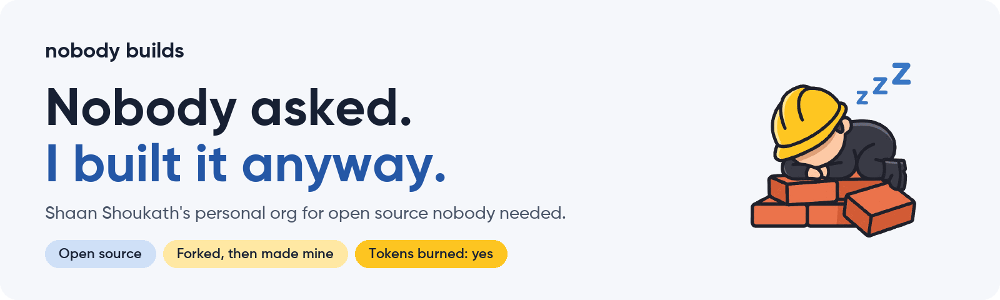
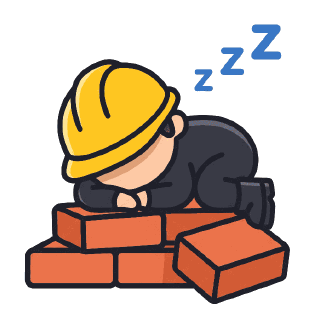

<picture>
  <source media="(prefers-color-scheme: dark)" srcset="https://raw.githubusercontent.com/Nobody-Builds/.github/main/profile/assets/banner-dark.png">
  
</picture>

**Nobody Builds is the personal org of [Shaan Shoukath](https://github.com/Shaan-Shoukath)**, where I build open-source projects nobody asked for. Some start from scratch. Most start as a fork of a project I like, which I then turn into my own product or tool with a new name, a new design, new features and my own fixes. Everything is built for fun, and it burns a lot of AI tokens and some ocean water along the way.

For example, [**Nobody Listens**](https://github.com/Nobody-Builds/Nobody-Listens) started as a fork of the [LMusic](https://github.com/Kunj-Company/LMusic-player) music player. It now has its own name and design, YouTube Music and JioSaavn streaming, and a standalone Galaxy Watch app.

**Forks keep their roots.** Each fork credits its original authors and keeps its upstream license. Fixes go back upstream when they fit.

Open an issue, send a pull request or star something. If you use something from here, you're officially somebody.

---

   
  Built by nobody. Well, by <a href="https://github.com/Shaan-Shoukath">Shaan-Shoukath</a>.

